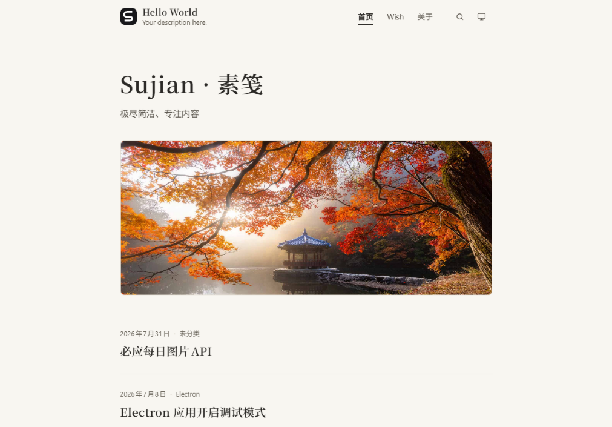

# SuJian（素笺）


一款简洁、专注阅读的 Typecho 个人博客主题。当前版本：**1.0.1**。

SuJian，中文名“素笺”，寓意一张简净的纸笺。文章、评论和页面信息由 Typecho 原生 PHP 模板渲染；搜索、移动菜单和外观选择通过 React 与 shadcn/ui（Base UI）组件增强。界面采用单栏布局，支持浅色、深色模式。

[项目主页](https://github.com/WishMelz/SuJian) · [版本发布](https://github.com/WishMelz/SuJian/releases) · [问题反馈](https://github.com/WishMelz/SuJian/issues)



## 1.0 功能

- 单栏文章列表、自动摘要与自定义摘要
- 响应式导航，支持逐项设置链接打开方式
- 统一的网站图标与页头 Logo，支持 ICO、PNG、SVG 地址
- 首页 Banner：固定图片、固定渐变色、随机渐变色
- 浅色、深色及跟随系统外观，支持五种主题强调色
- GitHub 风格正文排版、Typecho 原生评论与相邻文章导航
- 分类、标签、作者、日期归档、搜索结果与分页模板
- 可开关的友情链接独立页，使用分组输入项管理友链
- Open Graph、Twitter Card、Canonical 和 JSON-LD 页面元信息
- 可配置页脚 HTML、独立 404 模板与列表页链接预加载

主题仓库包含 `assets/ui/` 编译资源，正常安装不需要在服务器上运行 Node.js、pnpm 或 Composer。只有修改前端组件时才需要重新构建。

## 环境要求

- 兼容目标：Typecho 1.2+、PHP 7.4+；当前本地验证环境为 Typecho 1.3.0、PHP 8.0.2，不代表所有版本组合均已测试。
- 先确保 Typecho 本身正常运行，PHP 扩展、数据库与 URL 重写要求以所用 Typecho 版本为准。
- 主题自身的文本截取支持无 `mbstring` 回退，不代表可以省略 Typecho 或其他插件要求的扩展。
- 建议使用较新的 Chrome、Edge、Firefox 或 Safari，并开启 JavaScript。未承诺所有浏览器版本及插件组合均兼容。

React 增强资源未加载时，只要基础脚本仍正常执行，主题保留基础搜索、移动菜单和浅深色切换。完全禁用 JavaScript 不提供同等交互体验；列表预加载也取决于浏览器支持。

## 安装与升级

### 首次安装

1. 从版本发布页选择所需版本下载，或获取对应版本的仓库源码。
2. 解压并将主题目录命名为 `SuJian`，不要保留下载时附带的分支名或版本后缀。
3. 上传整个主题目录到 Typecho 的 `usr/themes/SuJian/`，确保 `index.php` 直接位于该目录下，而不是再嵌套一层文件夹。
4. 登录 Typecho 后台，进入“控制台 → 外观”。
5. 找到 **SuJian · 素笺** 并启用。
6. 进入“设置外观”，配置网站图标、导航、Banner 等，点击“保存设置”。默认导航含作者站点及项目链接，请替换为自己网站的实际链接。

上传时保留全部 PHP 模板、CSS、`favicon.svg`、`screenshot.png` 和整个 `assets/` 目录，尤其是：

```text
assets/ui/sujian-ui.js
assets/ui/sujian-ui.css
assets/js/sujian-script.php
assets/js/instantpage.js
assets/js/friends-editor.js
assets/css/friends-editor.css
assets/js/settings-editor.js
assets/css/settings-editor.css
```

前两项必须配套部署；只上传 PHP 或只上传其中一个构建文件，无法启用完整的增强交互。服务器不需要上传 `node_modules/` 或 `.git/`。

### 覆盖更新

更新前备份数据库、主题设置及自行修改过的主题文件，再替换主题目录中的文件。保持目录名不变，更新后重新检查设置和页面；有 CDN 或缓存插件时同步清理缓存。原“页头 Logo 图片地址”的已保存值继续用于新的“网站图标地址”，无需重新录入。

## 主题配置

### 网站图标与页头 Logo

在“设置外观 → 网站图标地址”中填写自定义图片地址。该地址同时用于页头 Logo 和浏览器网站图标，支持完整的 http/https URL 或以 `/` 开头的站内相对路径，建议使用正方形图片。ICO、PNG 和 SVG 均可使用；留空时使用主题自带的 `favicon.svg`。该设置不影响 SEO 站点 Logo。

例如 `https://example.com/uploads/logo.ico` 或 `/usr/uploads/logo.png`。以 `/` 开头的路径从域名根目录解析；若网站安装在 `/blog/` 下，请按实际位置填写 `/blog/usr/uploads/logo.png`。浏览器可能缓存 favicon，更换图标后可更换文件名或给地址增加版本参数。

启用 JavaScript 时，网站图标、SEO 图片和 Banner 图片字段会在保存时自动转换中文域名及中文路径，无需手工编码；原有中文图片地址重新保存设置即可转换。只检查地址格式和 http/https 协议，不检查图片是否可访问。禁用 JavaScript 时请使用已编码的地址。

### 导航

在“导航菜单”分组点击“添加导航”，填写名称、地址并选择打开方式。可用上移、下移按钮调整顺序，删除按钮移除项目；保存时自动生成兼容原配置的文本。

禁用 JavaScript 时回退到文本框，每行填写一个导航项：

    名称|地址|打开方式

打开方式支持 `self`（当前标签页）和 `blank`（新标签页），省略时默认为 `self`。地址支持以 `/` 开头的站内路径以及 `http`、`https` 绝对地址。例如：

    首页|/|self
    关于|/index.php/about.html|self
    GitHub|https://github.com/WishMelz/SuJian|blank

独立页面、分类、标签和搜索地址请先在网站中确认可访问，再将实际永久链接添加到导航数据中。若网站安装在子目录，站内路径需要包含子目录前缀。主题不自动创建“归档”页面，归档导航应使用你实际启用的 Typecho 归档地址。

### 评论

在“设置外观 → 评论 → 全站评论”中选择“关闭”并保存，文章、独立页面和友链页面不再输出评论列表、分页、回复表单或“评论已关闭”提示，归档列表也不显示评论数量。已有评论数据不会删除，重新开启即可恢复。

开关默认开启，仍遵循每篇文章或页面自身的评论权限；单篇关闭评论时，该页面同样不输出评论区域。

该开关控制主题展示，不修改 Typecho 的评论提交权限；若要禁止提交，还需关闭对应文章或页面的原生评论权限。

### 友情链接

1. 在“设置外观 → 友情链接页面”中选择“开启”（默认关闭）。
2. 在“友情链接”中点击“添加友联”，分别填写名字、头像地址、跳转地址和简介。用右侧上移、下移按钮排序，删除按钮移除项目，最后点击页面底部“保存设置”。无需编写 JSON 或手动填写分隔符。
3. 在后台“管理 → 独立页面”中新建页面，标题可设为“友情链接”，自定义模板选择“友情链接”，然后发布。正文可填写友联说明或申请要求，评论沿用该页面的评论设置。
4. 在“导航菜单”中添加一项，名称填“友情链接”，地址填发布后的实际永久链接，再选择打开方式。不要直接复制示例路径，以兼容固定链接规则和子目录安装。

- 宽屏每条友联的四个字段横向排列，窄屏自动换行。已有友联数据会自动回填，无需重新录入；原跳转地址为空时沿用站点地址。
- 名字、跳转地址必填；记录按表单中保存的顺序展示。完全空白的新行不会保存，填写不完整的记录会在对应字段提示。
- 头像留空时使用主题默认图片，建议使用正方形头像。
- 跳转地址为点击卡片后打开的地址，链接在新标签页中打开。
- 简介可留空，支持在简介中继续使用 `|`；其他字段内不要使用未编码的竖线，URL 中可用 `%7C`。
- 头像地址和跳转地址支持 http/https URL、协议相对地址和站内相对路径，编辑器会检查地址格式。
- 编辑器只检查地址格式和协议，不会检查目标网页或头像图片是否实际可访问；请自行确认填写的地址有效。头像 URL 有效但图片加载失败时，不会自动替换为默认图片。
- 关闭后，使用“友情链接”模板的页面返回 404，已填写的友联数据保留，重新开启即可恢复。手动添加的导航不会被删除，关闭时请同时移除对应导航行。

编辑器只在后台主题设置页加载，不依赖前台 React 构建。底层继续使用 `friendsData` 字段，保留五段格式以兼容旧数据和简介中的竖线，新记录的第三段留空；若浏览器禁用了 JavaScript，会回退到文本框，此时格式为 `名字|头像地址||跳转地址|简介`，可选字段留空但分隔符需保留。

可视化编辑器会规范化编辑过的友链地址，包括中文域名和路径。关闭友情链接时，隐藏输入项不参与校验，不会阻止其他设置保存；重新开启后恢复校验。无 JavaScript 的文本模式仍需自行使用 Punycode 域名和百分号编码路径。

### 文章链接

可统一设置首页和归档列表中文章标题及“阅读全文”链接的打开方式：

- 当前标签页：直接进入文章，文章顶部显示“返回文章列表”按钮，实际链接到站点首页，不恢复此前的分类、搜索或分页位置
- 新标签页：在新标签页中打开文章

相邻文章导航不受此设置影响。

### 文章置顶扩展

主题首页为 Typecho 的 `sticky()` 调用预留了置顶标记位置，但不内置文章置顶管理功能。需要置顶文章时，请安装或配置能够提供该调用的兼容插件；插件输出的标记样式由插件和自定义 CSS 决定。

### Banner

“顶部 Banner 样式”支持以下三种模式：

- 固定图片：填写以 `/` 开头的站内图片路径或完整的 http/https 图片 URL
- 固定渐变色：用角度、颜色和位置输入项编辑并实时预览；“高级 CSS”保留 `linear-gradient()` 括号内参数的编辑方式，复杂旧配置不会被自动覆盖
- 随机渐变色：每次请求从内置渐变色中随机选择

Banner 标题和描述留空时，分别使用 Typecho 的站点标题与站点描述。

默认模式为“固定渐变色”。“Banner 固定图片地址”的预填值是 `https://bing.xzxo.cn/img`，只有选择“固定图片”后才会请求该地址；第三方图片服务的可用性由其服务方决定，也可以替换为自己的图片地址。

### 外观

主题默认使用素笺灰，并提供紫罗兰、靛蓝、翡翠绿和玫瑰红四种可选强调色；支持跟随系统或手动切换浅色、深色模式，访客选择会保存在浏览器本地。

### SEO

主题设置支持配置：

- SEO 站点描述
- SEO 默认分享图片
- SEO 站点 Logo

主题会根据 Typecho 站点信息自动生成 Canonical、Open Graph、Twitter Card 和 JSON-LD 结构化数据。站点发布者 Logo 优先使用“SEO 站点 Logo”，留空时回退到“SEO 默认分享图片”；两者都为空或选中的地址不合法时不输出发布者 Logo。它与“网站图标地址”相互独立，也不会回退到某篇文章的封面。搜索结果、作者归档和 404 页面默认使用 `noindex`。搜索引擎站点验证等扩展功能可通过插件实现。

主题不额外提供 SEO 编辑面板，请在 Typecho 文章或独立页面编辑器的“自定义字段”中按名称添加以下字段：

| 字段 | 用途 |
| --- | --- |
| `seoDescription` | 页面 SEO 描述 |
| `seo_d` | SEO 描述兼容字段 |
| `customSummary` | 文章列表摘要，也可作为 SEO 描述 |
| `seoImage` | 页面分享图片，优先级最高 |
| `cover` | 分享图片兼容字段 |
| `thumbnail` | 分享图片兼容字段 |

分享图片按 `seoImage`、`cover`、`thumbnail`、正文中匹配到的第一张图片、主题设置中的 SEO 默认分享图片顺序选取。`cover` 和 `thumbnail` 在本主题中仅作为分享图片兼容字段，不会自动生成文章封面或列表缩略图。全部为空时不输出分享图片元标签。

### 页脚

页脚第一行内容支持 HTML，并支持以下占位符：

可在后台“页脚变量”下拉框选择变量并点击“插入变量”，无需手工输入占位符。

| 占位符 | 内容 |
| --- | --- |
| `{year}` | 当前年份 |
| `{siteTitle}` | 站点标题 |
| `{siteUrl}` | 站点地址 |
| `{description}` | 站点描述 |
| `{themeName}` | 完整主题名称 SuJian · 素笺 |
| `{themeNameEn}` | 英文主题名称 SuJian |
| `{themeNameZh}` | 中文主题名称 素笺 |
| `{themeUrl}` | SuJian GitHub 项目地址 |

页脚内置版权信息与 SuJian 主题署名，主题名称链接指向 GitHub 项目主页。

## 目录结构

    SuJian/
    ├── assets/css/        后台设置与友联编辑器样式
    ├── assets/js/         基础脚本、链接预加载和后台编辑器
    ├── assets/ui/         React 编译后的搜索、菜单和外观组件
    ├── 404.php            404 页面
    ├── archive.php        搜索与归档列表
    ├── comments.php       评论区域
    ├── favicon.svg        默认网站图标
    ├── footer.php         页脚与脚本资源
    ├── functions.php      主题功能与后台配置
    ├── ghmd.css           Markdown 正文样式
    ├── header.php         页头、导航与 SEO
    ├── index.php          首页
    ├── page-friends.php   友情链接独立页模板
    ├── page.php           独立页面
    ├── post.php           文章详情
    ├── screenshot.png     主题预览图
    ├── src/               React 组件与 UI 样式源码
    ├── tests/             PHP 回归测试与模拟文章页面
    ├── package.json       前端依赖与构建命令
    ├── pnpm-lock.yaml     前端依赖锁定文件
    ├── vite.config.ts     前端构建配置
    └── style.css          全局样式

## 开发

PHP 模板和全局 CSS 修改后刷新页面即可预览。交互层使用 React 19、shadcn/ui（base-nova）、Base UI 和 Tailwind CSS 4；Node.js 22.12+ 与 pnpm 10 仅在开发时需要。

包管理器版本在 `package.json` 中锁定为 pnpm 10.33.0。下面的 PHP 测试命令需要可用的 PHP CLI，其中模板测试使用 DOM 扩展；PHP 不在 PATH 时请使用本机 PHP 可执行文件的完整路径。

PHP 回归测试需要将主题放在完整 Typecho 安装的 `usr/themes/SuJian/` 中运行，部分测试会加载站点的 `var/` 核心文件。仅下载主题仓库不足以运行全部 PHP 测试。

在主题目录运行：

```sh
pnpm install --frozen-lockfile
pnpm typecheck
pnpm build
php tests/summary.php
php -n tests/summary.php
php tests/seo.php
php tests/header-logo.php
php tests/friends.php
php tests/friends-editor.php
php tests/comments.php
```

`php tests/friends-editor.php --render` 可输出独立的 Typecho 设置表单测试页；使用 `--render-checks` 则在页面加载后自动执行图片地址、协议校验、表单序列化与重置检查，在顶部输出结果。这些测试不加载数据库配置，也不保存站点设置。

### 模拟文章回归

打开 `tests/article-layout.html` 可检查长英文标题、长链接、代码块、表格和图片的窄屏布局。它引用主题真实 CSS，不创建数据库文章，也不出现在首页或 RSS；可直接用浏览器打开文件，或通过本站 `/usr/themes/Sujian/tests/article-layout.html` 访问。

添加 `?repro=1` 可恢复修复前的标题换行规则。在 320px 屏幕下，原行为会出现整页横向溢出，默认修复模式应只有代码块或表格内部滚动。建议同时检查 375、768、1280px 和浅深色模式。该页带有 `noindex`，发布包可排除整个 `tests/` 目录。

`pnpm typecheck` 只执行 TypeScript 检查；`pnpm build` 会先执行同样的检查，再通过 Vite 输出 `assets/ui/sujian-ui.js` 与 `assets/ui/sujian-ui.css`。提交或发布前确认这两个文件已生成并纳入发布包，不需要上传 `node_modules/`。文章、评论与 SEO 仍由 PHP 渲染；React 增强资源未能加载时，基础脚本正常执行的前提下仍可使用基础搜索、移动菜单和浅深色切换。

组件配置位于 `components.json`，源码位于 `src/`。更新组件时保留本地中文关闭标签与主题样式，不要直接覆盖自定义修改。

如需贡献代码，请先 Fork 项目并从独立分支提交 Pull Request；缺陷与建议可通过 [Issues](https://github.com/WishMelz/SuJian/issues) 反馈。

## 发布检查

以下是发布前待核对的清单，不代表所有环境都已完成验证：

- [ ] `index.php`、`functions.php`、`package.json` 和本文中的版本号保持一致
- [ ] 主题 PHP 文件通过 `php -l`，上面的 PHP 回归测试全部通过
- [ ] `pnpm build` 成功，两个 `assets/ui/` 编译文件均包含在待发布版本中
- [ ] 首页、文章、普通独立页、分类、标签、搜索和不存在的 URL 按预期显示
- [ ] 友链开启、关闭、保存、独立页模板，以及评论提交按预期工作
- [ ] 浅色、深色、桌面和手机下完成检查；搜索、菜单、图标及页面布局正常
- [ ] 预览截图反映当前外观，发布包包含 `README.md`、`LICENSE` 和全部运行资源
- [ ] 发布包不包含 `node_modules/`、`.git/`、站点数据库配置、数据库备份或私人上传文件
- [ ] 在干净的 Typecho 安装中试装发布包，确认没有依赖本机文件或未说明的插件

## 许可证

SuJian（素笺）基于 [MIT License](LICENSE) 开源，项目源码托管于 [GitHub](https://github.com/WishMelz/SuJian)。

Copyright © 2026 [WishMelz](https://github.com/WishMelz) and SuJian contributors.
